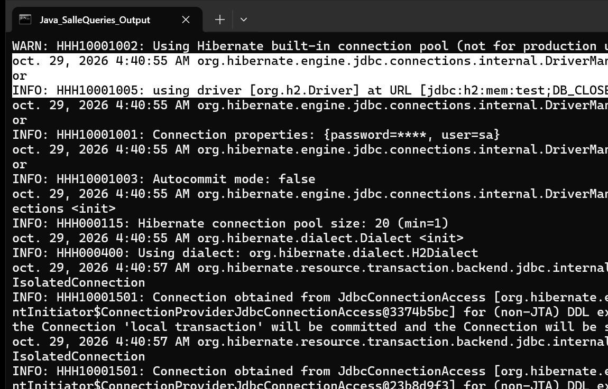

# TP 5 : Requêtes Avancées avec JPA - Disponibilité, Recherche Multi-Critères et Pagination

Implémentation d'une solution de gestion de réservations et de recherche avancée de salles utilisant JPA et Hibernate. Le projet met en œuvre des requêtes JPQL paramétrées, l'API Criteria de JPA pour la construction dynamique de requêtes multi-critères, ainsi qu'un mécanisme de pagination côté serveur.

## Fonctionnalités Implémentées

### 1. Recherche de Disponibilité par Créneau (JPQL)
- **Méthode :** `SalleRepository.findAvailableRooms(LocalDateTime debut, LocalDateTime fin)`
- **Principe :** Exclusion via sous-requête SQL (`NOT IN`) de toutes les salles possédant une réservation dont l'intervalle horaire chevauche le créneau demandé (`debut < r.fin AND fin > r.debut`).

### 2. Recherche Multi-Critères Dynamique (Criteria API)
- **Méthode :** `SalleRepository.searchRooms(String nom, Integer capaciteMin, LocalDateTime debut, LocalDateTime fin, int page, int size)`
- **Critères combinables :**
  - Filtrage insensible à la casse sur la désignation de la salle (`cb.like(cb.lower(...))`).
  - Filtrage sur la capacité d'accueil minimale (`cb.ge(...)`).
  - Filtrage sur la non-occupation durant un créneau temporel via sous-requête Criteria (`Subquery<Long>`).

### 3. Pagination Côté Serveur
- **Classe utilitaire :** `PaginationResult<T>` contenant la liste paginée des résultats, la page courante, la taille de page, le nombre total d'éléments et le nombre total de pages.
- **Requête de comptage :** `SalleRepository.countRooms(...)` utilisant `cb.count(...)` avec l'ensemble des prédicats dynamiques appliqués.
- **Découpage des résultats :** Application des limites via `query.setFirstResult(...)` et `query.setMaxResults(...)`.

## Architecture du Projet

- `com.example.model` : Entités JPA `Salle` et `Reservation`.
- `com.example.repository` : Interface `SalleRepository` et implémentation `SalleRepositoryImpl` (JPQL & Criteria API).
- `com.example.service` : Interface `SalleService` et implémentation `SalleServiceImpl` avec validation des intervalles temporels.
- `com.example.util` : `PaginationResult<T>` pour la structure de pagination.
- `com.example.App` : Classe principale exécutable pour la démonstration console.

## Exécution et Tests

### Commandes Maven
Compilation et exécution des tests unitaires :
```bash
mvn clean test
```

Exécution de la démonstration console :
```bash
mvn clean compile exec:java -Dexec.mainClass="com.example.App"
```

## Résultat d'Exécution

La capture ci-dessous montre la sortie console de l'application `com.example.App`.



### Description de la Capture
- L'en-tête confirme le démarrage de l'application et la persistance des salles de test et des réservations associées.
- Section 1 : Détection et affichage des salles disponibles sur le créneau demandé (09h30 - 11h30), excluant automatiquement la salle A101 réservée sur cette plage.
- Section 2 : Exécution de la recherche multi-critères dynamique (capacité >= 40 places et disponibilité), renvoyant les salles correspondantes.
- Section 3 : Démonstration du découpage paginé côté serveur (Page 1 et Page 2 avec taille de page fixée à 2).
- Confirmation de validation finale sans erreur.
